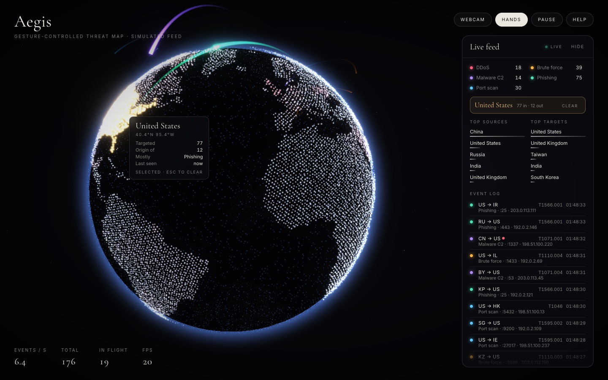
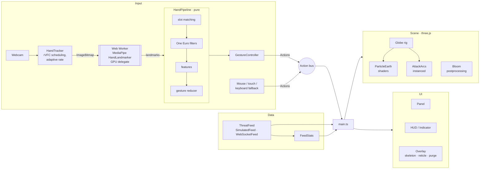

# Aegis

**A gesture-controlled 3D cyber threat map that runs entirely in your browser.**
Spin a 20,000-particle Earth with an open hand, spread two hands to zoom, point at a country to
inspect it, pinch to select it, and pinch-and-hold to purge every active attack in a shockwave.



> 🎬 **Demo GIF placeholder.** Record a short clip of the gestures (for example with Kap or
> ScreenToGif), save it as `docs/demo.gif`, and replace this note with ``.

> 🔒 **Privacy:** your camera stream never leaves your device. Hand tracking runs locally in a
> Web Worker; frames are never uploaded, stored, or sent anywhere. The app makes no third-party
> requests at all: the model, the WebAssembly runtime and the fonts are self-hosted.

---

## Features

- **Particle Earth**: ~20k GPU particles sampled from a land/ocean mask (an even lattice on land,
  a sparse dim scatter on the oceans), with a limb atmosphere, bloom and a slow auto-rotation.
- **Live attack arcs**: great-circle arcs fly from source to target country, colour-coded by attack
  type, with a launch pulse and an impact ring. Countries under heavy attack glow warmer.
- **Realistic simulated feed**: Poisson baseline traffic plus coordinated campaign bursts,
  weighted country pairs with geopolitical affinities, per-country attack mixes, and a MITRE
  ATT&CK technique ID on every event. Swap in a real feed behind one interface.
- **Hand tracking**: MediaPipe HandLandmarker (Tasks API, VIDEO mode, 2 hands) in a Web Worker
  on the GPU, landmarks smoothed with One Euro filters, and every gesture debounced with
  hysteresis. A gesture indicator always shows what was recognized.
- **Full mouse, touch and keyboard fallback** for every gesture. The camera is optional.
- **Live panel**: event log, top sources and targets, events/second, attack-type legend.
- **Respectful by default**: `prefers-reduced-motion` support, responsive layout, accessible
  controls, and clear errors for denied or missing cameras.

## Gestures

Finger counts use **thumb-first counting**: 1 = thumb, 2 = thumb + index, … 5 = open hand. That
way an index-only "point" is never mistaken for "1".

| Action          | Gesture                                                                                   | Mouse / keyboard                                 |
| --------------- | ----------------------------------------------------------------------------------------- | ------------------------------------------------ |
| Rotate          | One open hand: move it; flick and drop it for inertia                                     | Drag · arrow keys                                |
| Zoom            | Two hands: spread apart to zoom in, bring together to zoom out                            | Wheel · trackpad pinch · `+` / `−`               |
| Inspect country | Point with your index finger (thumb tucked)                                               | Hover                                            |
| Select country  | Quick pinch on a country · quick pinch on empty space clears                              | Click · `Esc` clears                             |
| Purge           | Pinch and hold on empty space until the ring fills, release                               | Press and hold on empty space · hold `Space`     |
| Pause / resume  | Make a fist and hold it for 1 s                                                           | `P` · Pause button                               |
| Filter by type  | Hold a count steady for 0.4 s: 1 DDoS · 2 Brute force · 3 Malware C2 · 4 Phishing · 5 All | `1`–`4` · `5` all · `6` port scan · click legend |
| Reset view      | —                                                                                         | `0`                                              |
| Toggle panel    | —                                                                                         | `L`                                              |
| Webcam backdrop | —                                                                                         | `B` · Webcam button                              |
| Hand skeleton   | —                                                                                         | `H` · Hands button                               |
| Help            | —                                                                                         | `?`                                              |

**Robustness rules**

- Every pose uses separate enter and exit thresholds (hysteresis), and every action needs a
  minimum hold (debounce).
- A dropped frame never ends a gesture.
- Counts 4 and 5 double as the open hand, so they only apply after a deliberate 1–4 count. Stopping
  a rotation never resets your filter.

## Architecture



Both input paths emit the same `Action` vocabulary, so nothing downstream knows (or cares)
whether a hand or a mouse produced it. That is what makes the fallback complete.

```
src/
  main.ts                 wiring: scene, feed, input, UI, render loop
  app/                    action vocabulary, tiny bus and store
  scene/                  stage (renderer, adaptive DPR), globe rig, particles, arcs, postfx, shaders/
  input/                  handTracker + handWorker, pipeline, features, gestures, oneEuro,
                          gestureController, mouseFallback, recorder (dev)
  data/                   types (ThreatFeed, AttackEvent), simulator, countries, stats, geo,
                          feeds/websocket.ts
  ui/                     hud, panel, help, indicator, overlay, tooltip, start screen, styles.css
tests/                    Vitest suites + synthetic hand model + recorded fixtures
```

## Setup

Requires **Node 22.12+**.

```bash
npm install
npm run dev          # http://localhost:5173 (localhost counts as a secure context for the camera)
```

The first `dev` or `build` runs `scripts/setup-mediapipe.mjs`. It copies the MediaPipe wasm
runtime out of `node_modules` and downloads the hand-landmarker model (about 7.8 MB) once into
`public/mediapipe/`. That folder is git-ignored.

```bash
npm run check        # lint + type-check + tests
npm test             # Vitest only
npm run build        # production build in dist/
npm run preview      # serve dist/ locally
```

Dev-only extras:

- `?debug=nobloom,noatmo` disables render layers.
- **Shift+R** records gesture landmarks (see below).

### Deploy to GitHub Pages

1. Push this repository to GitHub.
2. In **Settings → Pages**, set **Source** to **GitHub Actions**.
3. Push to `main`. `.github/workflows/deploy.yml` lints, type-checks, tests, builds with the right
   base path, and publishes to `https://<user>.github.io/<repo>/`.

Pages is served over **https**, which browsers require for webcam access.

**Vercel** also works with zero config: import the repository and Vercel detects Vite and runs
`npm run build`. The model download runs as part of the build.

## Plugging in a real threat feed

Every source implements one interface (`src/data/types.ts`):

```ts
interface ThreatFeed {
  readonly name: string;
  readonly paused: boolean;
  start(): void;
  stop(): void;
  setPaused(paused: boolean): void;
  subscribe(fn: (e: AttackEvent) => void): () => void;
}
```

`src/data/feeds/websocket.ts` is a ready-made adapter with reconnect and backoff. Write a
`normalize(raw) → AttackEvent | null` for your source and swap one line in `main.ts`:

```ts
const feed: ThreatFeed = new WebSocketFeed('wss://example.org/threats', normalize);
```

For an AbuseIPDB or AlienVault OTX export, parse each record, resolve the countries to ISO 3166-1
numeric codes and coordinates (see `src/data/countries.ts`), and classify it into one of the five
attack types.

## Testing

Gesture recognition is a set of **pure functions over landmarks**:

- `features.ts` maps landmarks to finger extension, pinch and palm features.
- `gestures.ts` is a reducer from state and frame to new state, events and an indicator.

The tests drive it with a parametric synthetic hand (`tests/fixtures/syntheticHand.ts`) through the
full pipeline: slot matching, One Euro, features and reducer. They cover:

- rotate direction and inertia release
- zoom engage and deadband
- point, pinch-tap select/deselect, charge/purge/cancel
- fist pause
- finger counts, including the rule that stopping a rotation never resets a filter

**Recording real fixtures:**

1. Run `npm run dev` and enable the camera.
2. Press **Shift+R**, perform a gesture, then press **Shift+R** again. A JSON file of raw landmarks
   downloads.
3. Drop it into `tests/fixtures/recorded/` and list the event types it must (and must not) produce:

```json
{ "meta": { "label": "fist-pause", "expect": ["togglePause"], "forbid": ["chargeStart"] }, "frames": [ … ] }
```

Every file in that folder is replayed by `npm test`.

## Performance

- Particles, arcs, impacts, the purge explosion and highlighting all animate in shaders. Spawning
  an arc writes a few instance attributes into a ring buffer.
- Hand detection runs in a Web Worker, one frame in flight, on downscaled frames. Its rate drops
  from 30 Hz to as low as 10 Hz when render frames run long, and recovers when they're healthy.
- Render resolution adapts too: the pixel ratio drops after sustained slow frames.
- three.js ships as a separate cached chunk. The app chunk is about 71 kB gzipped.

## Accessibility

- With `prefers-reduced-motion`:
  - auto-rotation, shimmer and twinkle stop
  - arcs appear and fade instead of travelling
  - the purge clears without the explosion or shockwave
- All controls are real buttons with keyboard shortcuts. The help sheet and start screen are
  proper dialogs.

## Data & credits

- All attack events are **simulated**. Country weights are illustrative, not measurements.
  Source IPs come only from the RFC 5737 documentation ranges, so no real host is implicated.
- Country shapes: [Natural Earth](https://www.naturalearthdata.com/) (public domain) via
  [`world-atlas`](https://github.com/topojson/world-atlas) (ISC).
- Hand tracking: [MediaPipe Tasks Vision](https://ai.google.dev/edge/mediapipe) (Apache-2.0).
- Rendering: [three.js](https://threejs.org/) (MIT) and
  [postprocessing](https://github.com/pmndrs/postprocessing) (Zlib).
- Fonts: Cormorant Garamond and Inter (SIL OFL) via Fontsource.
